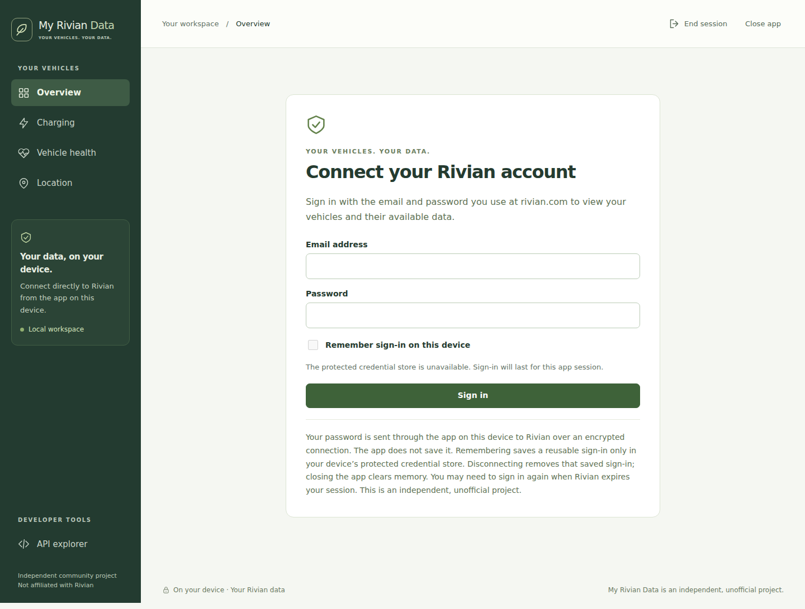
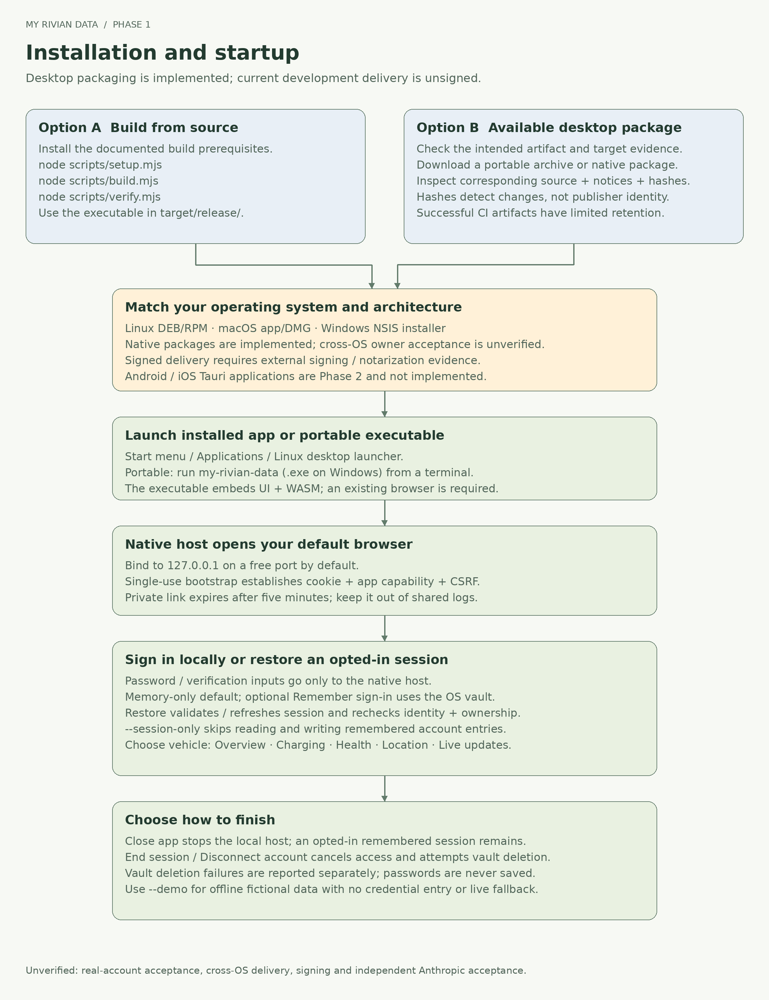

# My Rivian Data

**Your vehicles. Your data.** My Rivian Data gives Rivian owners a local interface
for information associated with the vehicles they own, organized around charging,
vehicle readings and location. Run the desktop app on your computer and use your
existing browser. Native Rust connects directly to the unofficial Rivian API.

The Phase I desktop implementation includes account sign-in, optional remembered
sign-in, available vehicle reads and native live updates. **Real Rivian account and
vehicle compatibility are still unverified.** This is an independent community
project, not affiliated with Rivian. See [status and acceptance limits](docs/STATUS.md)
before treating a development build as a supported release.

## For vehicle owners

| View | Information shown when Rivian supplies it |
| --- | --- |
| **Overview** | Battery charge, estimated range, charging state and passenger-door locks |
| **Charging** | Charging state, charge limit and power, plus available charging sessions |
| **Vehicle health** | Odometer, temperature and passenger-door locks; valid tire pressures through live updates |
| **Location** | Reported coordinates and location accuracy |

Choose your account vehicle and switch between these areas. **Refresh data**
requests a new snapshot. **Start live updates** connects native telemetry for the
selected vehicle. Each field retains its own vehicle-reported time; a connected
stream does not make all readings current. Missing values remain unavailable.
Battery charge is never presented as battery health, and tire pressure is not a
tire-condition assessment.

Read the [owner guide](docs/OWNER-GUIDE.md) for sign-in, live updates and help. The
screenshots show the earlier desktop interface; demo screenshots contain fictional
readings and do not establish live compatibility.

## Start the app

1. Obtain a package matching your operating system and architecture from a
   successful [GitHub Actions](https://github.com/asanderson/my-rivian-data/actions)
   run. The development workflow produces unsigned artifacts. See the
   [owner guide](docs/OWNER-GUIDE.md#get-started) for native installation, or extract
   the portable `.tar.gz` package. Developers can [build from source](docs/DEVELOPER-GUIDE.md#build-from-source).
2. Launch the installed app. For a portable package, open a terminal in the
   extracted folder and run `./my-rivian-data` on Linux/macOS, or
   `.\my-rivian-data.exe` in Windows PowerShell. On Linux/macOS, run
   `chmod u+x my-rivian-data` first if necessary.
3. Your default browser opens the local app. Sign in with your Rivian email and
   password, and complete account verification if requested.
4. Choose **Close app** to stop the native app. Choose **Disconnect account** or
   **End session** when you also want the app to remove remembered sign-in.

Passwords are never saved. A new sign-in stays in native memory unless you choose
**Remember sign-in on this device**. That choice stores a reusable session only
in Linux Secret Service, macOS Keychain or Windows Credential Manager. An
unavailable credential store leaves memory-only sign-in available; there is no
plaintext fallback. Previously remembered sessions are checked again when the app
starts. Use `--session-only` to disable access to remembered entries entirely.

For a credential-free preview, run `./my-rivian-data --demo` (Windows:
`.\my-rivian-data.exe --demo`). Demo mode uses two fictional vehicles and clearly
labeled sample readings, accepts no Rivian credentials and does not contact Rivian.

A built executable embeds the interface and WASM module. Rust, Node.js, npm and a
separate web server are not runtime requirements. Native installer, integrity,
rollback and signing workflows are implemented; actual signing, notarization and
clean-machine acceptance remain external release gates. Android/iOS apps are not
implemented.

## Developers

**Developer tools → API explorer** shows a fixed 244-row catalog tied to the
versioned 234-surface known-source inventory. The build admits 33 fixed read
operations and one vehicle rename mutation. The rename requires review of the
exact change and a native, one-use confirmation that expires after two minutes.
Physical vehicle controls, command signing and key enrollment remain blocked.
Catalog membership alone never grants execution authority.

The explorer displays reviewed contracts, variables and bounded request/response
JSON. Document import accepts only an exact endpoint, operation name and document
already admitted by this build; it resolves to a fixed local operation. It does
not expand the catalog or create a generic GraphQL proxy. Native live telemetry
subscribes only to eleven reviewed read topics.

Phase I preserves the chosen Rust/Axum host, React interface and shared Rust/WASM
validation. Phase II will reuse Rust and React through Tauri native invocations
on Android/iOS; those mobile hosts are not implemented.

- [Developer guide](docs/DEVELOPER-GUIDE.md)
- [Architecture, security boundary and data flow](docs/ARCHITECTURE.md)
- [API coverage and source provenance](docs/API-COVERAGE.md)
- [Standalone PNG diagrams and editable sources](docs/diagrams/README.md)
- [Implementation status and release gates](docs/STATUS.md)
- [Security review and threat model](docs/SECURITY-REVIEW.md)
- [Desktop packaging and release](docs/RELEASE.md)
- [Desktop and owner acceptance](docs/ACCEPTANCE.md)

Original project code uses the [GNU GPLv3 license](LICENSE) (`GPL-3.0-only`).
Dependencies retain their own [licenses and notices](docs/THIRD-PARTY-NOTICES.md).
