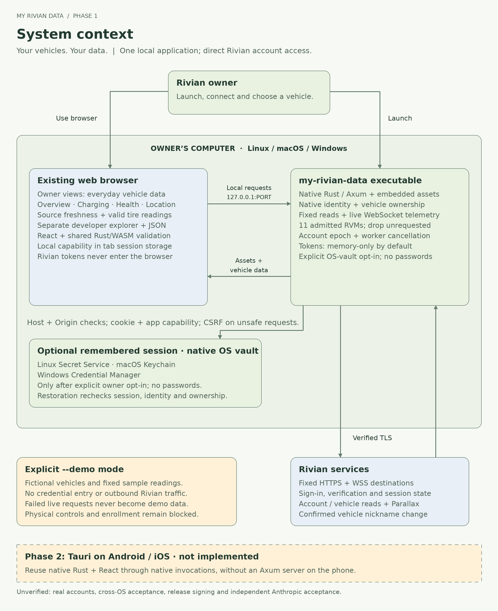
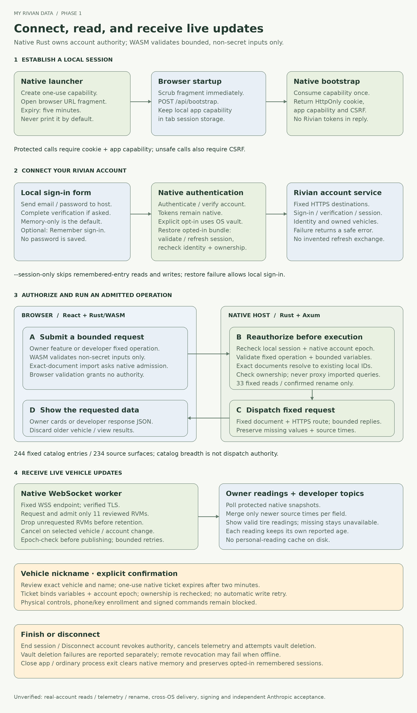

# Architecture and design

[Owner guide](OWNER-GUIDE.md) · [Developer guide](DEVELOPER-GUIDE.md)

Phase I preserves the chosen standalone Rust/Axum host, embedded React interface
and shared Rust/WASM validation. Native Rust owns account authority, fixed HTTPS
requests, optional protected session storage and the native live WebSocket.
`--demo` selects credential-free synthetic data at process launch. An API request
cannot switch modes. Phase II Tauri Android/iOS hosts are not implemented.

## System context

The owner runs one executable and uses an existing browser. Only native transport
contacts Rivian. There is no project-operated cloud backend, browser extension,
external map service or persistent vehicle-history database.

## Source boundaries

| Component | Responsibility |
| --- | --- |
| `rivian-core` | Fixed operations and reviewed inventory, bounded validation, response normalization, portable Parallax decoding and deterministic fixtures; no credentials or network I/O |
| `rivian-wasm` | Non-secret bindings around the same portable validation; browser decisions remain advisory |
| `rivian-host` | IPv4 loopback, embedded assets, launcher, local session checks, account-epoch admission, telemetry controls and one-use rename confirmations |
| `rivian-api` | Native account lifecycle, fixed HTTPS/WSS transport, owned-resource authorization, optional OS-vault access, bounded replies and sanitized errors |
| `ui` | Owner views, separate API explorer, transient account forms, per-field source times and guarded rendering of bounded results |
| `fixtures` | Synthetic native/WASM conformance and Parallax examples; no owner secrets or vehicle data |
| `scripts` / `packaging` | Locked builds, integrity manifests/SBOMs, native installers, optional signing, local installation/rollback, measurements and acceptance helpers |

The executable embeds `ui/dist`, including WASM. Node, Vite, Cargo and
wasm-bindgen are build tools, not runtime subprocesses. The planned mobile host
will invoke native Rust through Tauri; it will not run an Axum loopback server.

## Owner presentation and freshness

| View or action | Local operation or route | Presentation boundary |
| --- | --- | --- |
| Sign-in and verification | `/api/account/login`, `/api/account/otp`, `/api/account/otp/resend` | Transient password/code input; native challenge and tokens |
| Remember sign-in | `/api/account/vault`, `/api/account/remember` | Sanitized status and explicit opt-in; no browser token access |
| Vehicle selection | `/api/vehicles` | Vehicles discovered for the native authenticated account |
| Overview and vehicle health | `vehicle-state` plus selected-vehicle telemetry | Nullable readings; four passenger-door locks; valid stream tire measurements |
| Charging | `charging-status`, `charging-history` plus telemetry | Available status and explicitly associated sessions; no charging setting changes |
| Location | `vehicle-location` plus telemetry | Coordinates and source age; no map or disk history |
| Live updates | `/api/telemetry/start`, `/api/telemetry`, `/api/telemetry/stop` | Native selected-vehicle stream; local snapshots polled sequentially by the browser |
| API explorer | Catalog, validation, execution, document admission and confirmation routes | Fixed contracts and bounded JSON under the same native authority |

HTTP receipt time is distinct from vehicle observation time. Normalization and
stream merge preserve per-field source times. Only a non-null stream value with a
newer source time replaces the corresponding HTTP value; absent tags do not become
zero or false. Explicitly encoded zero/false remains a valid reading. Partial,
empty and out-of-order messages cannot make unrelated values appear fresh.

Tire pressure requires a reported physical measurement, source time and valid
source validity. Invalid/unknown validity suppresses the value. The reported tire
age follows the pressure/status measurement, so a later validity envelope does
not refresh old pressure. The decoder follows the pinned schema's proto3 validity
control default; it does not synthesize missing pressure. Charging power and
remaining time are withheld when the derived charging state is no longer active.

View/vehicle/account changes discard older browser results. Native epochs and
cancellation independently reject stale work. A failed live request never becomes
demo data, and switching presentation never changes backend privileges.

## Fixed catalog and document admission

The build exposes 244 catalog rows derived from a versioned inventory of 234 known
source surfaces. It admits 33 fixed HTTP reads, one confirmed vehicle nickname
write, and a separately controlled native telemetry subscription. Documented and
blocked entries are visible for inspection; inventory membership is not execution
permission. Exact mappings and pinned provenance are in [API coverage](API-COVERAGE.md).

`/api/catalog/admit` accepts only a byte-exact GraphQL document together with its
reviewed operation name and fixed endpoint. It resolves that triple to an existing
local operation and validates the variables. It never sends the supplied document,
adds a contract or chooses a new network destination. Execution still reconstructs
the build's fixed document and independently checks native account authority.

Vehicle reads require native account-owned vehicle IDs. Order and wallbox reads
also refresh their native account-resource authorization. A syntactically valid
identifier or successful WASM validation does not establish ownership.

## Local HTTP contract

The host binds only to IPv4 `127.0.0.1`. Host must exactly match its address and
port. A supplied Origin must match the application origin; unsafe requests require
it. Cross-site and same-site cross-origin fetch metadata are rejected. There is
no permissive CORS policy.

Bootstrap exchanges a random 256-bit, one-use, five-minute URL-fragment capability.
The browser scrubs the fragment before rendering. Bootstrap is consumed atomically
and returns a host-only HttpOnly SameSite=Strict cookie, independent application
capability and CSRF state. The launch URL is printed only with explicit
`--print-launch-url`.

Every protected request, including session recovery, needs both cookie and
`x-app-capability`. Unsafe methods also require CSRF. The application capability
is in origin-scoped tab `sessionStorage`; Rivian tokens never enter it. Cookies
lack port isolation, so cookie-only recovery is deliberately rejected. CSRF stays
in memory. Local sessions have one-hour idle and eight-hour absolute limits.

| Route group | Methods | Native effect |
| --- | --- | --- |
| `/api/health`, `/api/bootstrap` | GET, POST respectively | Nonsensitive mode/build status; one-use local session establishment |
| `/api/session` | GET | Protected local session recovery |
| `/api/account`, `/api/account/vault` | GET | Sanitized account and vault status |
| `/api/account/login`, `/api/account/otp`, `/api/account/otp/resend` | POST | Fixed native authentication flow; rejected in demo mode |
| `/api/account/remember`, `/api/account/logout` | POST | Opt-in storage or disconnect/forget |
| `/api/catalog`, `/api/vehicles` | GET | Reviewed metadata and authorized account vehicles |
| `/api/validate`, `/api/execute`, `/api/catalog/admit` | POST | Native validation, admitted reads and exact-document resolution |
| `/api/telemetry`, `/api/telemetry/start`, `/api/telemetry/stop` | GET, POST, POST | Bounded native snapshot and selected-vehicle stream lifecycle |
| `/api/commands/prepare`, `/api/commands/execute` | POST | Prepare and consume a confirmation for the sole admitted write |
| `/api/logout`, `/api/application/quit` | POST | End/forget local session, or close native app while preserving prior opt-in storage |

Only health and bootstrap are exempt from local session requirements. There is
no generic URL proxy, arbitrary signing, shell, filesystem or token-read route.

## Session sequence

Native account authority is captured before body extraction or queued work and
rechecked before dispatch and release of results. Login/account change, logout,
expiry and revocation advance the account epoch and cancel older requests and
subscription credentials. An older failure cannot invalidate a newer account.
POST handlers also recheck the local session after extracting a body.

The native password/OTP exchange uses fixed Rivian TLS destinations. Application
session renewal follows reviewed upstream behavior; no refresh-token grant or
stored-password re-login is invented. Reads allow at most one application-session
renewal retry. Invalid user sessions require sign-in again. MFA challenges expire
after ten minutes or five attempts; resend has a 30-second cooldown and does not
extend expiry or rotate an undocumented challenge token.

## Remembered sign-in

Memory-only is the default for a new sign-in. Explicit owner opt-in stores only a
bounded reusable native session bundle and account identity, never a password or
MFA challenge. The only production backends are Linux Secret Service, macOS
Keychain and Windows Credential Manager. Explicit backend selection prevents a
mock backend fallback; unavailable/locked storage cannot fall back to a plaintext
file. `--session-only` disables both reading and writing remembered entries.

One fixed native credential entry is protected by an exclusive per-user lease for
the store lifetime. Its lock file contains no secret; a competing process makes
storage unavailable instead of replacing/deleting another instance's entry.
Store work is serialized, run off the async executor and bounded by a ten-second
wait. OS blocking calls cannot be forcibly canceled, so generation checks and
serialized cleanup prevent a late write from restoring revoked authority.

Startup restoration bounds and checks the bundle, enforces a 30-day local
retention ceiling, rotates application state and revalidates pinned account
identity plus current owned vehicles with Rivian. This ceiling is not Rivian's
token lifetime. Disconnect/End session attempt deletion and report failure
separately from local erasure or remote logout. Close app/process exit preserves
previously opted-in storage. A stored bundle does not establish account authority
until native restoration succeeds.

## Native telemetry

One native worker connects to the fixed Rivian WSS endpoint using
`graphql-transport-ws`, opaque native credentials and exactly eleven reviewed read
RVMs. Neither the browser nor the catalog can select arbitrary endpoints/topics.
The native response gate drops every unrequested RVM before decode or retention,
including known key-material topics; unexpected payloads never reach developer
snapshots. The portable decoder remains independent of network authority.

Handshake, acknowledgement, writes, heartbeat and idle waits are finite. Retry
backoff is bounded and stops after eight reconnect attempts; authentication
rejection requires sign-in rather than an automatic password replay. Stop,
vehicle replacement and native account revocation cancel connection and backoff
work and clear telemetry. Browser polling is sequential and cannot repopulate a
newer selection from a closed poller.

## Confirmed vehicle rename

`rename-vehicle` is the only admitted write. Ordinary `/api/execute` rejects it.
Preparation checks the exact variables and current account-owned vehicle, then
stores a random native ticket bound to the local session, account epoch,
operation and variables. At most eight tickets can be pending; each expires after
two minutes and is removed before dispatch, including wrong-epoch/expired use.

Execution accepts only the ticket ID, rechecks native authority and uses the
stored exact change. It never retries the mutation automatically. A transport or
ambiguous response reports an unknown outcome and directs the owner to inspect
the name before trying again. Physical controls, key enrollment/BLE pairing and
command signing remain cataloged and blocked until legitimate enrollment and
acceptance evidence exist.

## Bounds and defense in depth

- HTTP JSON bodies: 32 KiB; variables: 16 KiB, depth 8, at most 256 values.
- WASM linear memory: maximum 64 MiB; this does not bound total browser memory.
- Upstream HTTP reply: 1 MiB; browser adapter envelope: 3 MiB; finite request timeouts.
- WebSocket frame/message: 128 KiB; decoded Parallax payload: 32 KiB; bounded topic state and developer payload representation.
- Fixed documents, explicit variable schemas and native account/resource authorization.
- Restrictive CSP, bundled scripts and narrow WASM evaluation; React text rendering for JSON.
- `no-store`, `nosniff`, no-referrer, framing prevention and cross-origin response isolation.
- Static traversal, encoded aliases and dotfiles rejected before asset lookup.

These controls assume a trusted OS, browser and extensions. Same-origin script
execution, process inspection, swap or crash dumps can expose transient inputs
and capabilities. OS-vault protection inherits the device's credential-store
security. See the [security review](SECURITY-REVIEW.md).

## Delivery and external acceptance

Native installers and portable archives, clean-revision rebuilds, source/lock
provenance, complete file hashes, SPDX/CycloneDX SBOMs, rollback tools and optional
platform signing/notarization workflows are implemented. Ordinary CI artifacts
are unsigned. A checksum detects changes but does not authenticate a publisher.
A configured signing workflow does not establish an actual signature, nor does
an installer source file establish clean-machine acceptance.

[Release guidance](RELEASE.md) describes the target matrix and protected signing
inputs. [Acceptance](ACCEPTANCE.md) covers local synthetic resource reports,
platform lifecycle checks and owner-entered real-account results. Current evidence
and unrun gates are in [status](STATUS.md). Actual account/firmware compatibility,
Windows/macOS and baseline Linux acceptance, signing/notarization and independent
Anthropic adversarial review require external evidence. They cannot be closed by
mock tests or same-provider review.

Phase II mobile lifecycle, Tauri hosts and device/store packaging are not
implemented. There is no persistent vehicle-history collection or remote updater.

## References and licensing

[API coverage](API-COVERAGE.md) traces reviewed contracts and source revisions.
Framework references: [Axum](https://docs.rs/axum/latest/axum/),
[wasm-bindgen](https://wasm-bindgen.github.io/wasm-bindgen/),
[Vite](https://vite.dev/guide/) and
[rust-embed](https://docs.rs/rust-embed/latest/rust_embed/).
Original project code is GPL-3.0-only; dependencies retain their own
[licenses and notices](THIRD-PARTY-NOTICES.md).
