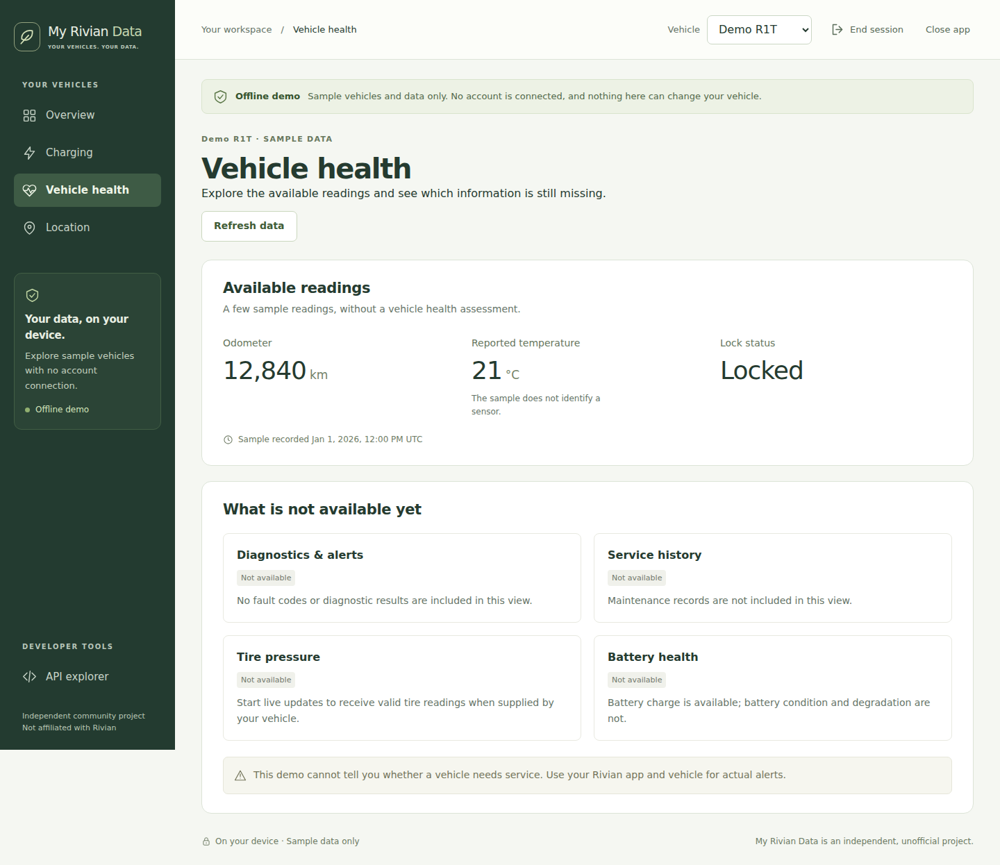
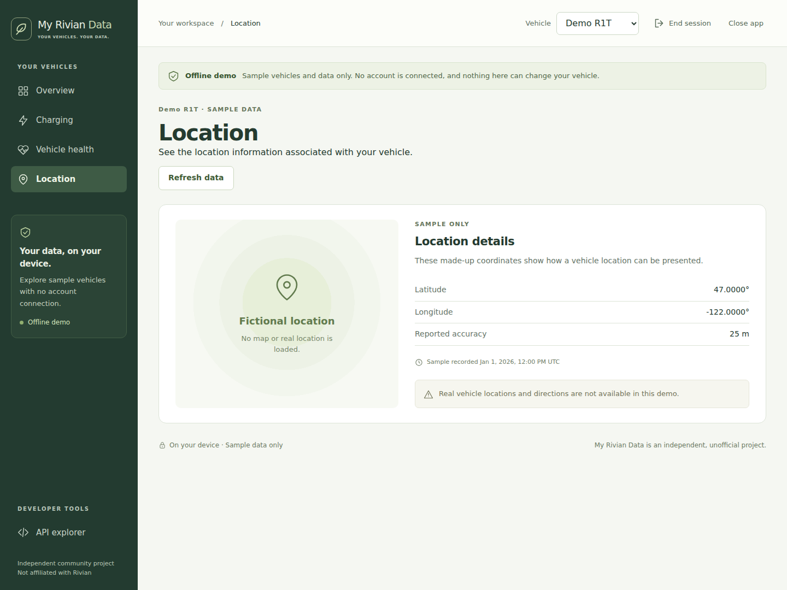
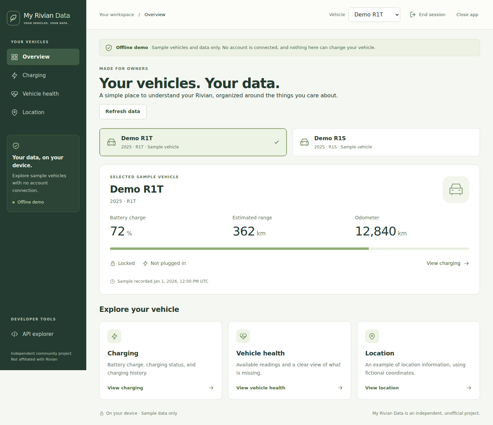
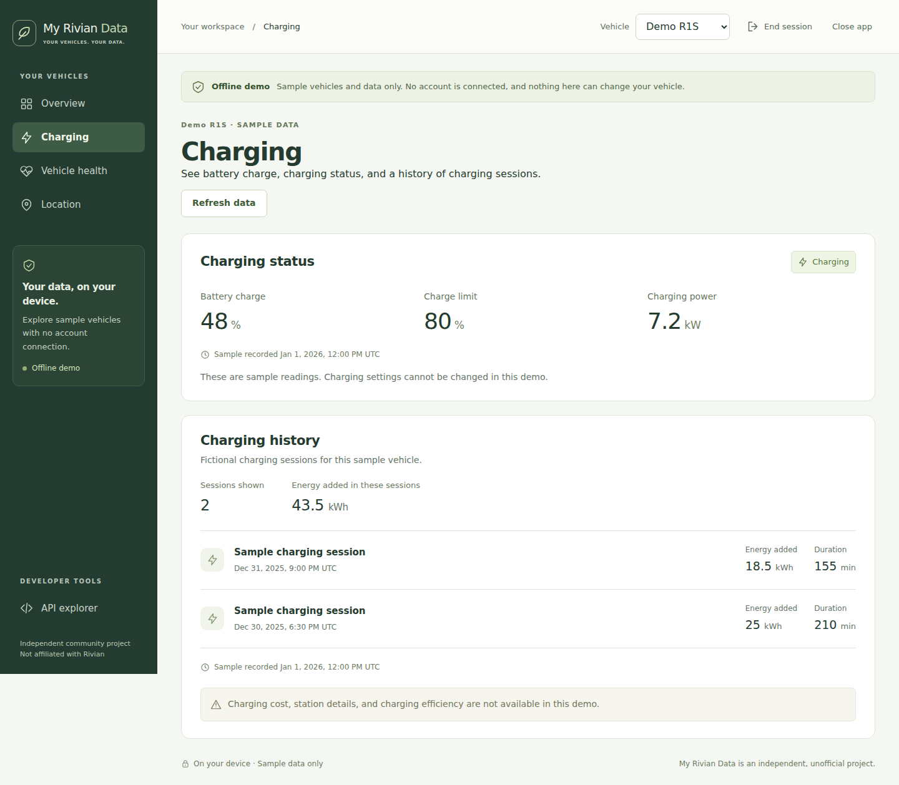

# Owner guide

[Project overview](../README.md) · [Developer guide](DEVELOPER-GUIDE.md)

**Your vehicles. Your data.** My Rivian Data runs on your computer and requests
available information directly from Rivian. Choose your vehicle, then use
**Overview**, **Charging**, **Vehicle health** and **Location**. Developer tools
are separate from the everyday owner views.

This is an unofficial development build. Real account, vehicle and firmware
compatibility have not been verified. See [implementation status](STATUS.md) for
recorded evidence and remaining release gates.

## Get started

Obtain the package matching your desktop operating system and architecture from
a successful [GitHub Actions job](https://github.com/asanderson/my-rivian-data/actions).
The development workflow produces unsigned packages. The implemented packaging
paths are listed below; successful source builds do not establish interactive
installation or OS trust acceptance.

| Package | Install and launch |
| --- | --- |
| Windows x64 setup executable | Open the installer, then use the per-user Start Menu shortcut |
| macOS Intel x64 or Apple Silicon arm64 DMG | Open the DMG, copy the app to Applications or `~/Applications`, then open it |
| Linux x64 DEB or RPM | Install the local package with your package manager, then use the desktop menu or `my-rivian-data` |
| Portable `.tar.gz` | Extract the whole package, open a terminal in its folder and run the executable |

For a portable package, run `./my-rivian-data` on Linux/macOS, or
`.\my-rivian-data.exe` in Windows PowerShell. On Linux/macOS, run
`chmod u+x my-rivian-data` first if necessary. Keep its terminal open while using
the app. The extracted folder includes `START-HERE.txt`. Developers can also
[build from source](DEVELOPER-GUIDE.md#build-from-source).

The app opens your default browser at a private local page. Sign in there with
your Rivian email and password. Enter the verification code if Rivian requests
one. **Resend verification code** asks Rivian to send another code for the
pending challenge; requests are limited and do not extend its ten-minute expiry.
Use **Use a different account** to start over.

A built app does not require Rust, Node.js, npm or a separate web server. Each
package is specific to its operating system and architecture. Signed packages
and notarization require completed release evidence; no such success is claimed
here. Android/iOS applications are not implemented. A mobile-width browser layout
is not a phone application.

*Screenshots show the earlier desktop interface. Demo screenshots contain
fictional readings; they are not verified live-account data.*

## Sign-in and privacy

Your password is used for sign-in and never saved. A new account connection stays
in the running native app's memory by default. Rivian tokens are not returned to
the browser, placed in browser storage or written to a plaintext file.

Choose **Remember sign-in on this device** only when you want a reusable session
saved in your device's protected credential store: Linux Secret Service, macOS
Keychain or Windows Credential Manager. You can choose it during sign-in or while
connected. Previously saved sessions are checked with Rivian on startup, including
account identity and the current vehicle list. A remembered session can expire;
the app cannot promise that you will never need to sign in again.

If the credential store is unavailable or locked, ordinary memory-only sign-in
remains available. Another running copy can also make remembered storage
unavailable. The app reports saving or deletion problems. Turning remembering off
attempts to delete the saved session while keeping the current connection open.
To run without reading or writing any saved session, launch with `--session-only`.

The browser keeps a separate temporary local-app capability in this tab's session
storage so reload can reconnect to the running app. It is not a Rivian token.
Browser session restore behavior varies; use the session controls when finished.
Do not share your password, verification code or private launch link. Inspect
and redact developer responses before sharing them because they may contain
personal vehicle information.

## Choose a vehicle and read data

Use **Vehicle** to choose a vehicle returned for your account. The selection
carries across owner views. Native Rust checks account ownership before making
a vehicle request; entering a different identifier in developer tools does not
grant access to it.

Owner views request snapshots when opened or refreshed. **Refresh data** requests
another snapshot. Missing values mean that usable data was not supplied; they do
not mean zero, a fault or an unlocked vehicle. Vehicle-reported times are separate
from the time the app received a response. Different fields can have different
ages.

## Live updates

Choose **Start live updates** to receive available telemetry for the selected
vehicle. The connection status shows connecting, connected, reconnecting,
stopped, sign-in required or unavailable. Updates follow the selected vehicle;
changing vehicles stops the older connection. Choose **Stop live updates** to
stop receiving telemetry.

Live updates replace a snapshot field only when the vehicle reports a valid,
newer value for that field. Omitted fields keep their previous values and times.
A battery update does not make the displayed location or tire pressures current.
Expand the reporting-time details to inspect freshness. Reconnecting does not
prove the vehicle has sent a complete set of readings, and real-vehicle stream
compatibility remains unverified.

Live updates do not collect a disk history. If they are unavailable, you can still
try the ordinary HTTP snapshot reads. A rejected Rivian session requires sign-in
again; the app does not silently replay your password.

## Overview

See battery charge, estimated driving range, charging state and passenger-door
lock status. The lock reading covers the four passenger doors; it does not certify
that the frunk, tailgate or every opening is secure. Battery charge measures
stored energy, not battery condition or degradation.

## Charging

See reported charging state, battery charge, configured charge limit and charging
power. Charging history shows up to 100 sessions at a time that Rivian explicitly
associates with the selected vehicle, with the energy and duration fields it
supplies. Unassociated sessions are not assigned by guess. This is not a complete
billing record or a guarantee that every charging session is included.

The charge limit is a readout. This build does not start or stop charging or change
charging settings. Power and remaining-time readings are withheld when the
reported state is no longer charging, so old values do not imply active charging.

## Vehicle health

See available odometer, temperature and passenger-door lock readings. Live updates
can supply tire pressures for the four wheel positions. Pressure appears only
when the source reports a valid measurement with a reporting time. Invalid or
unknown validity leaves pressure unavailable. A newer validity message does not
make an older pressure measurement fresh.

This view does not assess tire condition, diagnose the vehicle or calculate a
health score. Battery health, fault codes, service history and maintenance
recommendations are not provided. A reported temperature is not a diagnostic
result.

*Earlier demo screenshot; tire telemetry is available only through live updates.*

## Location

See reported latitude and longitude, accuracy and reporting time when available.
The returned position may differ from the vehicle's current position. There is
no map, route history, disk collection or third-party map service.

## Disconnect, end or close

| Control | Effect |
| --- | --- |
| **Disconnect account** | Clears the native account connection, stops telemetry and attempts to remove saved sign-in; the local app remains open for another sign-in |
| **End session** | Revokes local browser access, clears native account state and attempts to remove saved sign-in; relaunch to open a new workspace |
| **Close app** | Revokes local access and stops the native process; a previously opted-in saved sign-in remains for a later launch |

Closing the browser tab alone does not stop the app. A portable terminal launch
can also be stopped with Ctrl+C. Closing or stopping the process clears its memory
but preserves any explicitly remembered session.

Disconnecting or ending the session attempts remote Rivian logout. Local access
is removed even if the network fails; remote revocation cannot be guaranteed when
Rivian is unreachable. If saved-session deletion fails, the app reports that
separately. Unlock the credential store and retry the indicated removal step.
When using `--session-only`, the app does not access saved entries, including to
delete an entry saved by an earlier launch.

## Try the demo

Run `./my-rivian-data --demo`, or `.\my-rivian-data.exe --demo` in PowerShell.
It uses **Demo R1T** and **Demo R1S** with fictional locations and fixed sample
timestamps. It never accepts Rivian credentials, accesses remembered sign-in or
contacts Rivian. Reopening a view reads the same fixed examples.

## Help

| What you see | What to do |
| --- | --- |
| Browser did not open | Keep the app running and use the [manual launch option](DEVELOPER-GUIDE.md#launcher-options); keep its one-use link private |
| Session ended or expired | Relaunch the executable and sign in on the new local page |
| Sign-in or verification fails | Follow the displayed error; resend when allowed or start over after expiry; use the official app to resolve an unsupported challenge |
| Protected storage unavailable | Unlock your OS credential store or close another running copy; memory-only sign-in remains available |
| Live connection unavailable | Stop and start live updates to retry, or refresh ordinary snapshots; real-vehicle compatibility is unverified |
| Requests are limited | Wait before trying again; rejected requests are not continuously retried |
| A vehicle or value is missing | Check the account and selected vehicle; available fields vary and an asleep vehicle may not report new values |
| Values never change in demo mode | Expected: demo readings and times are fixed examples |
| Package will not start | Check OS/architecture, extract all files and see [acceptance limits](STATUS.md) and [installation guidance](RELEASE.md) |

## For developers

Open **Developer tools → API explorer** for the fixed reviewed catalog and bounded
request/response JSON. Its **rename-vehicle** operation is the only admitted write:
prepare the exact new name, review it and explicitly confirm. Confirmation expires
in two minutes, works once and sends a real change to Rivian. If the outcome is
unknown, check the actual vehicle name before preparing another change; the app
never retries it automatically. Physical controls and key enrollment are blocked.

The [developer guide](DEVELOPER-GUIDE.md) explains reviewed document admission,
validation, telemetry, build and packaging. Owner features do not require that view.
